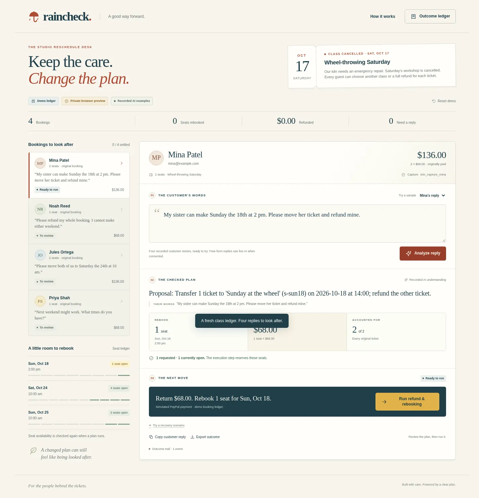

# Raincheck ☂

**One cancelled workshop. A good next plan for every guest.**

[**Try the interactive preview →**](https://blucca.github.io/raincheck/)

[**Watch the 88-second, captioned demo →**](https://blucca.github.io/raincheck/public/demo.html) · [YouTube](https://youtu.be/YuRDifk8XN8) · One booking, one Sunday place, one $68 refund.

Running a cancelled class today? [**Download the free planning sheet**](https://blucca.github.io/raincheck/public/raincheck-planning-sheet.xlsx), or [have a plan prepared for **US$29 per batch, up to 30 bookings**](https://blucca.github.io/raincheck/public/demo.html#pilot). The assisted service delivers a worksheet, open questions and guest-message drafts; the operator executes changes in their own tools. [Scope and worked example](docs/planning-sheet.md).

A kiln breaks. Four bookings need attention. One pair wants to split: a sister can attend Sunday, the other person wants her money back. Another guest wants a full refund. A third group wants to move together. Someone still needs the available times.

Raincheck turns those replies into **specific rebookings and refunds**, holds the remaining places, and follows every payment through to a settled outcome.

[](https://blucca.github.io/raincheck/)

## Try it in 60 seconds

1. Open the [preview](https://blucca.github.io/raincheck/) and select **Mina**.
2. Click **Analyze reply**. Her two tickets become **one Sunday place + a $68 refund**.
3. Open **Try a recovery scenario**, select the interrupted-response option, and run the plan.
4. Recover the refund. The same saved operation settles **one refund and one seat**.
5. Try Noah's full refund, Jules's two-person transfer, and Priya's open question.

The public preview uses **fictional bookings, simulated payments, and recorded real AI outputs**. It runs privately in your browser; Reset demo clears its local workspace. The Node app also supports live structured AI and a PayPal sandbox adapter.

## Why this workflow

Small teaching businesses publicly describe PayPal payments, limited places, and full refunds when the teacher cancels. Bookwhen's own workflow spans contacting guests, transferring tickets, refunding through the payment gateway, and recording the refund back in the booking system.

Raincheck puts a **whole cancelled class** on one desk: customer choices, places left, pending questions, and payment outcomes.

[Research and first-party sources](docs/research.md) · [How the recovery works](docs/architecture.md) · [Live model observations](docs/model-observations.md)

## Run the complete app

Requires Node.js 24.5+; developed with Node.js 26. The app uses built-in HTTP, SQLite, and fetch. Dependencies to install: **0**.

```sh
git clone https://github.com/blucca/raincheck.git
cd raincheck
npm start
# http://127.0.0.1:4326
```

The default app replays the recorded examples with a durable simulated payment ledger. Data lives in `temp/runtime/`; set `RAINCHECK_DATA_DIR` to choose a private directory.

```sh
npm test
```

Focused checks cover cancellation outcomes, restart recovery, seat capacity, exact ticket/quote validation, and the sandbox checkout API contract.

### Live AI

The interpreter calls an OpenAI-compatible structured-output endpoint. The demonstrated model is **NVIDIA Nemotron 3 Super 120B A12B on Nebius Token Factory**.

Copy `.env.example` to a private environment file, configure the `NEBIUS_*` values, and create a private budget from `budget.example.json`. Supply the account's confirmed credit allowance, chosen request cap, model prices, and expiry. Every model request reserves its maximum cost durably before HTTP. The sample budget starts inactive.

```sh
node --use-env-proxy --env-file=/path/to/private/raincheck.env src/server.mjs
```

New replies use live AI. The application computes amounts and checks availability from the saved booking. AI selects intent; the teacher confirms the proposed action.

### PayPal sandbox

The integration uses the free PayPal sandbox exclusively. The app now includes a **three-step checkout desk**:

1. Configure `PAYPAL_SANDBOX_CLIENT_ID` and `PAYPAL_SANDBOX_CLIENT_SECRET` in a private environment file. Use a fresh `RAINCHECK_DATA_DIR`.
2. Open **[local Sandbox checkout](http://127.0.0.1:4326/sandbox.html)** and create Mina’s **two-seat, $136 test order**.
3. Approve it with a virtual Personal sandbox buyer, then click **Capture approved order**.
4. Raincheck reads the capture and matches the booking, amount, currency, and order ID. The capture is saved directly into the cancellation workspace.
5. Open the cancellation desk, analyze Mina’s reply, and execute **one Sunday seat + one $68 refund**.

[**Complete sandbox setup and recovery guide →**](docs/sandbox-guide.md)

The default sandbox workspace has one fictional guest with a payment awaiting capture. The default simulated workspace retains all four stories. Each workspace keeps its payment mode and payment history across restarts.

A captured ticket can be refunded in full. A multi-person booking can split between full ticket refunds and equal-price rebookings. `PayPal-Request-Id` is saved with the exact amount and capture before a refund call. Known refund IDs are reconciled by GET.

**Integration status:** checkout and recovery are implemented; automated checks use explicit API fixtures. The developer-account run is the next milestone for real sandbox order → approval → capture → $68 refund → GET receipt. The public preview continues to use simulated payments and recorded AI.

## Scope

This first version handles **one merchant's captured USD tickets**, fixed per-ticket prices, equal-price replacement classes, and teacher-approved outcomes. The cancellation policy gives each guest a choice of a replacement class or their full ticket value. The teacher's local workspace is the source of seat availability; external booking-system write-back is a future integration.

Run one Node process for each workspace database. Browser previews use a local fictional workspace; live server deployments need their own access and customer-data controls.

## Build and license

New work for the **PayPal AI Hackathon**, started October 12, 2026. Research, product design, code, and test work use AI agents. Runtime AI and its observed failures are documented. The MIT credit-budget module is adapted from [DockProof](https://github.com/blucca/dockproof); this product's class-recovery workflow, interface, payment adapter, and shared browser/server state machine are new.

MIT. Feedback from teachers and workshop operators is welcome through [GitHub issues](https://github.com/blucca/raincheck/issues) or [email](mailto:belgialucca@gmail.com).
