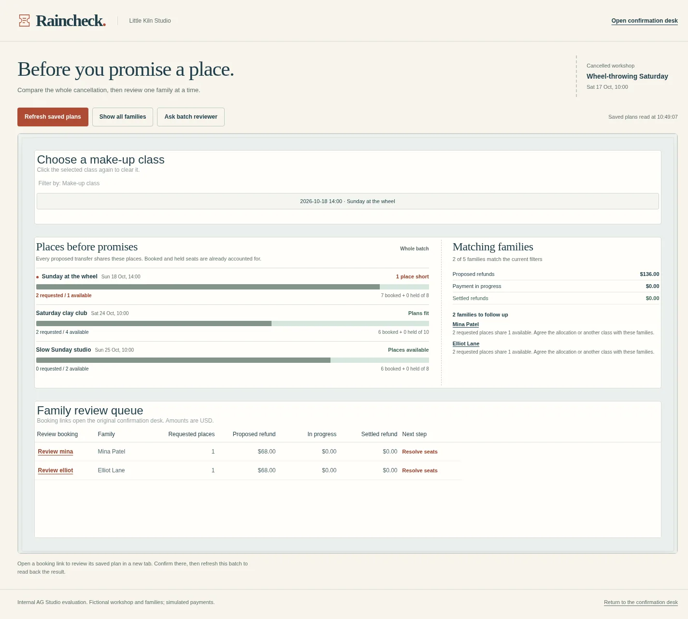
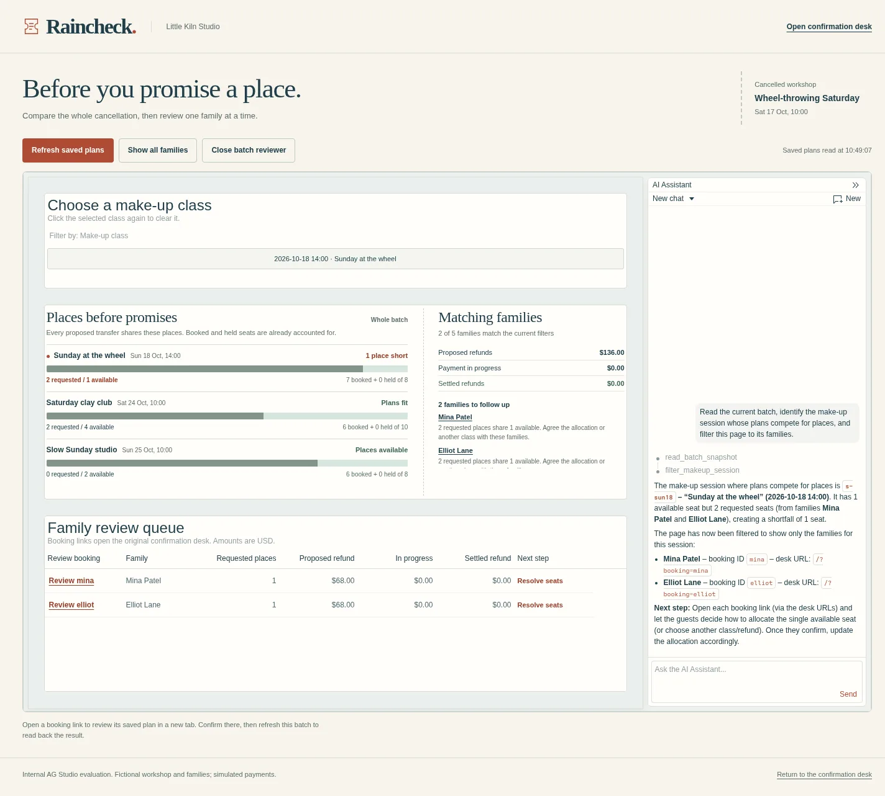

# Find the families sharing the last place

The optional **AG Studio batch preflight** brings every prepared customer choice into one working view. Choose a replacement class, see the families asking for its places, and open a family in Raincheck's existing confirmation desk.

The custom seat-pressure widget shows the **whole batch's** requested places alongside current availability. The native session filter and family grid narrow the review queue. Refunds have separate planned, in-progress, and settled amounts. Refresh reads the saved workspace after a household's outcome changes.



## Run the local module

Use Node.js 24.5+ and your own valid [AG Studio licence](https://www.ag-grid.com/studio/license-pricing/?tab=trial). The module uses **AG Studio 3.0.0**, installed separately from Raincheck's zero-dependency core.

From the Raincheck repository:

```sh
SDK="$PWD/temp/ag-studio"
DEMO="$PWD/temp/batch-demo"
mkdir -p "$SDK"
npm pack ag-studio@3.0.0 --pack-destination "$SDK"
tar -xzf "$SDK/ag-studio-3.0.0.tgz" -C "$SDK"
node docs/seed-batch-demo.mjs "$DEMO"

RAINCHECK_STUDIO_BUNDLE="$SDK/package/dist/umd/ag-studio.min.js" \
RAINCHECK_STUDIO_LICENSE_FILE="/absolute/path/to/private/studio-license-key.txt" \
RAINCHECK_DATA_DIR="$DEMO" \
RAINCHECK_SCENARIO_FILE="$DEMO/scenario.json" \
npm start
# http://127.0.0.1:4326/studio/
```

The seed script creates five fictional households with **scripted batch plans and simulated payments**. Choose a fresh data directory for each clean demonstration. Your existing PayPal sandbox workspace keeps its payment history in its original directory.

### The last-seat example

1. Select **Sunday at the wheel**. Mina and Elliot each want one place; the class has one place available. Both households need an agreed allocation.
2. Open **Mina** in the family grid. The existing desk shows one Sunday transfer and one $68 ticket refund. The teacher confirms this proposal in that desk.
3. Return to the batch and refresh. Sunday now has zero places available; Elliot's one-place request remains open. The refund summary separates the completed $68 from the remaining $136 in proposed refunds across the batch.
4. Clear the class filter to review Noah's full refund, Jules's two-person transfer, and Priya's open question.

The batch view reads state. The confirmation desk owns seat reservations, refund requests, and recovery. Its execution-time capacity check remains active when another household has taken the final place.

## Ask the Studio analyst

Configure the [existing live model and both private budgets](../README.md#live-ai), then add `RAINCHECK_STUDIO_AI=1` to the local environment. Studio's native Agent Framework runs a focused batch reviewer with read, query, and page-filter tools. A `read_batch_snapshot` tool supplies saved household plans and exact capacity/refund totals.

The model connection uses the same server-side provider, durable budget reservation, and private response log as the customer-reply interpreter. The analyst can inspect and filter the workspace; payment actions stay in the household confirmation flow.



### Observed on October 14, 2026

- Native class selection displayed Mina and Elliot together: two requested places, one available, $136 in their proposed refunds.
- The live analyst read the batch and called `filter_makeup_session` with the real session ID. Studio applied the native page filter; the family grid displayed the same two households.
- The first analyst run reached its tool-step limit after supplying incorrect arguments to Studio's general filter tool. The session-specific tool now validates a class ID and supplies the native filter's field object itself.
- Opening Mina's existing desk, interrupting a simulated refund response, and refreshing showed one held place and $68 in progress. Recovery completed that same operation. A second refresh showed zero holds and $68 settled; the other proposed refunds totalled $136 across the batch.
- The 390px-wide page kept its working table inside a labelled horizontal scroll area. Browser page errors: zero.

## Data and installation boundaries

- `GET /api/batch` projects the saved Raincheck workspace into households, replacement classes, and totals. Amounts are integer USD cents.
- Proposed demand counts plans awaiting confirmation. Available places subtract both booked and held seats. During recovery, held places and pending refunds keep their own columns.
- All customer choice and seat state comes from Raincheck's local workspace. A refreshed snapshot gives every widget the same view.
- The Studio bundle stays in its separate SDK directory. The server reads the licence from the supplied private file at runtime. Raincheck's application code is MIT; AG Studio has its own licence.
- This integration is a local evaluation module. The public Raincheck preview continues to run the browser-based household desk.

Focused check: `node --test tests/batch.test.mjs` exercises competing families, an interrupted refund, settlement, and the final execution-time capacity check.
