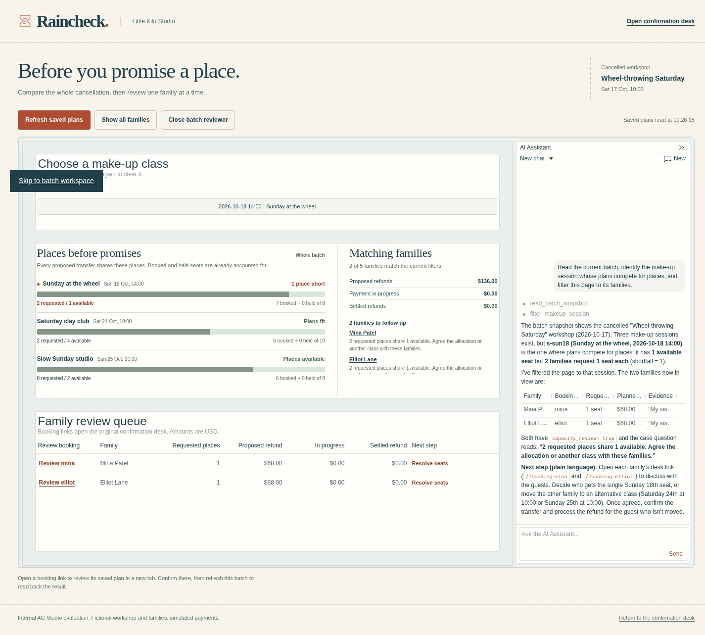

# Current live runtime: November 11, 2026

Raincheck's October film used NVIDIA Nemotron 3 Super 120B A12B on Nebius. That model retired on November 9. The current server, environment example and budget example use **NVIDIA Nemotron 3 Ultra 550B A55B**. Recorded previews and the original film retain their October outputs.

## Verified current paths

A fresh local workspace ran Node.js 26.12.0 and AG Studio 3.0.0. Its five households and initial plans were fictional; all payments in this check were simulated.

- **Native Studio analyst:** read the whole-batch snapshot, called `filter_makeup_session`, and completed its response. The actual family grid showed Mina and Elliot: **2 of 5 families**, requesting two Sunday places against one available.
- **New customer wording:** the live interpreter produced one Sunday transfer and one full-ticket refund. Application policy verified the quoted evidence and both ticket counts, then computed **6,800 USD cents** from the saved ticket price.
- **Existing recovery:** a simulated interrupted refund resumed the same saved operation. The outcome completed with **8 Sunday places booked, zero held, and 6,800 cents settled**.
- Browser page errors: zero.

[Structured result](live-verification-20261111.json)

## Run it

Use the [complete app and live-AI instructions](../README.md#live-ai) and the [five-household Studio setup](batch-preflight.md). Supply a valid Studio licence, a supported model endpoint and your own two active private credit budgets. Both budgets use the same model ID and its current prices. Start with a fresh data directory.

The [October PayPal sandbox verification](sandbox-verification.md) records the actual virtual-fund checkout, capture, refund and independent GET receipt. The current check above exercises the model migration and existing simulated recovery.
