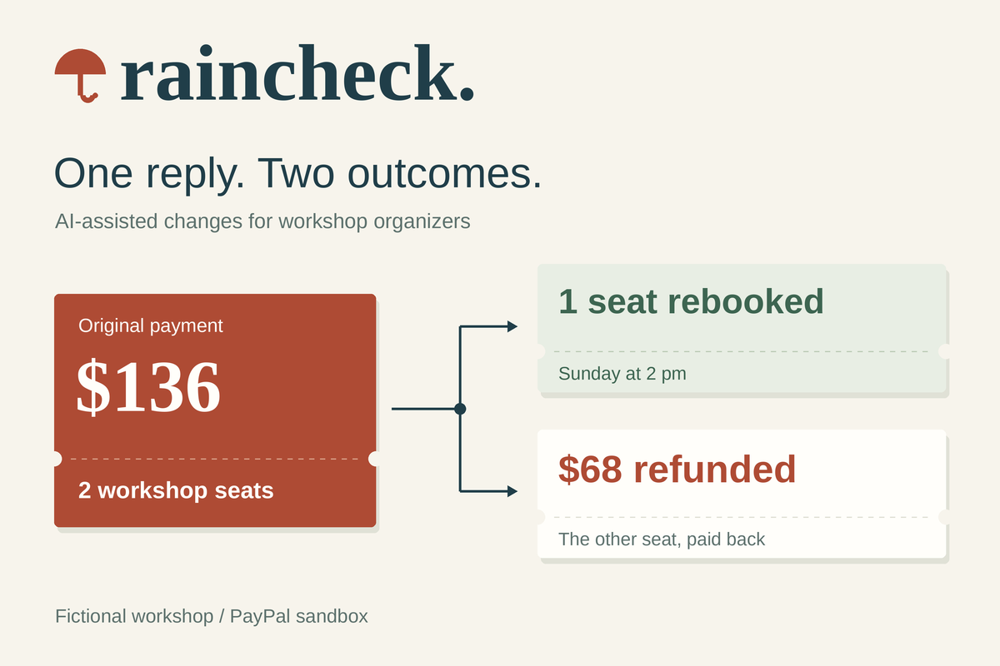

# Raincheck — Devpost submission draft

**[Submitted to the PayPal AI Hackathon](https://devpost.com/software/raincheck-l145bd) on October 13, 2026.** Entry 1233915. The story, integration answers, and media below accompany the official entry.

## Project story

### Inspiration

A cancelled class creates a second job for the person who was supposed to teach it.

Bookwhen’s [cancellation](https://support.bookwhen.com/en/articles/3790128-cancelling-an-event) and [refund](https://support.bookwhen.com/en/articles/753627-refunds) instructions describe contacting guests, handling tickets, refunding through the payment gateway, and recording those refunds back in the booking system. [Mark H Rooney Taiko’s public policy](https://www.markhrooney.com/registration-and-cancellation-policies/) makes the stakes concrete: full PayPal payment reserves a limited place; a weather or teacher cancellation earns a full refund.

We designed around a simple two-person booking: “My sister can come Sunday. Please move her ticket and refund mine.” That is one payment, two people, and two promises the studio needs to keep.

### What it does

Raincheck gives a small workshop operator one desk for a cancelled class: guest replies, available replacement places, questions to resolve, and settled outcomes.

In our fictional pottery workshop, a broken kiln cancels Saturday’s class. Mina paid $136 for two $68 tickets. Her sister takes Sunday’s last place; Mina receives her full ticket value back. The original payment receives a $68 partial refund because the two guests chose different outcomes.

AI reads the reply and proposes the split. The application checks ticket counts, the saved price, and available capacity. The teacher reviews the proposal and runs it. A completed PayPal receipt closes the refund and confirms the new seat together. The outcome includes a receipt and a customer-message draft.

The browser preview also covers a full refund, a two-person transfer, an open question, and recovery from an interrupted payment response. Its fictional workspace uses simulated payments and recorded AI outputs.

### How we built it

The complete application uses Node.js’s built-in HTTP server, SQLite, and fetch, with native HTML, CSS, and JavaScript. A shared execution core powers the browser preview and the durable SQLite workspace.

PayPal anchors the original transaction. A three-step sandbox checkout creates the order, takes virtual-buyer approval, and captures payment. Raincheck reads the order and capture, matches the booking reference, amount, and currency, then saves that verified binding.

Live NVIDIA Nemotron 3 Super 120B A12B on Nebius interprets a newly worded reply into structured ticket counts, a destination class, and an exact supporting quote. The application derives the action and calculates money in integer cents.

Execution saves the original capture, exact refund body, and unique `PayPal-Request-Id` while holding the replacement seat. That local transaction commits before the HTTP request. Recovery uses the saved operation and PayPal GET receipts; a known refund ID leads straight to its existing resource. A completed, matched receipt converts held seats into confirmed places.

### Challenges we ran into

The difficult boundary was a payment response arriving late or disappearing while the last replacement seat was at stake. Raincheck preserves an unresolved operation and its seat hold, then reconciles the receipt against the original capture, operation reference, amount, and currency.

Early model runs also exposed conflicting action labels and ticket counts. We simplified the model’s job to explicit intent fields and moved action selection into the shared policy. Execution accounts for every original ticket; ambiguous replies become a specific question for the guest.

### Accomplishments that we’re proud of

Our 105-second film follows actual PayPal sandbox calls and live inference: a $136 capture, a $68 completed refund, one rebooked seat, a workspace reload, and an independent refund lookup. Funds are virtual and participants are fictional. A separate account-connected verification also restarted the server: the completed case persisted, with eight booked places and zero remaining holds in the replacement class.

The MIT source, runnable setup guide, accessible preview, captioned film, free planning workbook, and $29 assisted planning offer are all published.

### What we learned

The useful unit of work is a guest’s complete next plan. Language, seats, money, and the message back to the guest belong in the same reviewable outcome. Giving uncertainty a visible place in the desk keeps the operator’s next action clear.

### What’s next

We have invited three independent studios to review the workflow. Our next milestone is an operator-led cancellation: measure handling time, accepted replacement places, settled refunds, and repeated questions. The published $29 service covers a plan for up to 30 bookings; operators approve and execute changes in their own tools. Those first cases will guide booking-system integration and batch-capacity planning.

### AI tools and original work

Raincheck began on October 12, 2026 for this hackathon. Its workflow, interface, PayPal adapter, and shared execution core are new work. A small MIT-licensed model-request budget module was adapted from [DockProof](https://github.com/blucca/dockproof). OpenAI Codex / GPT-6 Astra handled agent-led research, design, implementation, focused testing, documentation, and submission preparation; a human owner manages accounts and payments. Amazon Polly synthesized the English demo narration. Runtime reply interpretation uses the live Nemotron model described above.

## Submission fields

### Project name

Raincheck

### Tagline

Turn a cancelled class into confirmed next plans. AI reads each guest’s reply; PayPal refunds and replacement seats settle together.

### Built with

JavaScript, Node.js, SQLite, HTML, CSS, PayPal Orders API, PayPal Payments API, PayPal Sandbox, NVIDIA Nemotron 3 Super 120B A12B, Nebius Token Factory, GitHub Pages

### Public project / website URL

https://blucca.github.io/raincheck/

### Public video URL

https://youtu.be/Tj6nW_1W3TU

Duration: **105 seconds**. English synthetic narration, open captions, and a caption track. The [website player](https://blucca.github.io/raincheck/public/demo.html) also provides a transcript.

### Source code URL and license

https://github.com/blucca/raincheck

MIT. The repository includes the browser preview, complete Node application, tests, setup instructions, research sources, and public verification records.

### Run / testing instructions

**Immediate browser walkthrough:** Open https://blucca.github.io/raincheck/, select Mina, and choose **Analyze reply**. Review the one-seat rebooking and $68 refund. Open **Try a recovery scenario**, choose the interrupted-response option, run the plan, then recover the saved refund. Explore Noah, Jules, and Priya for the other outcomes. This public workspace uses fictional bookings, simulated payments, and recorded AI outputs.

**Complete live sandbox build:** Follow https://github.com/blucca/raincheck/blob/main/docs/sandbox-guide.md. Use Node.js 24.5+, a PayPal sandbox application and virtual buyer, and a configured Nebius model endpoint. The application uses Node’s built-in modules. Start the server with the private environment configuration and open `http://127.0.0.1:4326/sandbox.html`. Create and approve the two-ticket order, capture it, then open the cancellation desk for live reply interpretation and a sandbox refund. Credentials remain in the local environment.

The current workflow serves one merchant’s captured USD tickets, fixed ticket prices, equal-price replacement classes, and teacher-approved outcomes. The saved workspace supplies replacement-seat capacity.

### AI tools and their uses

- **NVIDIA Nemotron 3 Super 120B A12B on Nebius Token Factory:** live runtime interpretation of guest replies into structured transfer/refund counts, a target class, clarification state, and supporting quote. Application policy computes the monetary amount, validates capacity and ticket counts, and executes the teacher-approved outcome.
- **OpenAI Codex / GPT-6 Astra:** AI-agent research, product and interface design, implementation, focused testing, documentation, and submission preparation. A human owner manages accounts and payments.
- **Amazon Polly:** synthesized English narration for the final demo film.
- The public browser preview replays labeled outputs from actual model runs. The final film shows newly worded input processed by the live model.

### New work and open-source reuse

Raincheck was started on October 12, 2026 for this hackathon. The cancelled-class workflow, product interface, PayPal checkout/refund adapter, and shared browser/server execution core are new work. A small MIT-licensed model-request budget module was adapted from [DockProof](https://github.com/blucca/dockproof).

### Supporting evidence / additional links

- [105-second player and transcript](https://blucca.github.io/raincheck/public/demo.html)
- [Account-connected sandbox verification](https://github.com/blucca/raincheck/blob/main/docs/sandbox-verification.md)
- [Recording conditions and sequence](https://github.com/blucca/raincheck/blob/main/docs/sandbox-demo.md)
- [Execution and recovery architecture](https://github.com/blucca/raincheck/blob/main/docs/architecture.md)
- [First-party workflow research](https://github.com/blucca/raincheck/blob/main/docs/research.md)
- [Free cancellation-planning workbook](https://blucca.github.io/raincheck/public/raincheck-planning-sheet.xlsx)
- [$29 assisted planning scope](https://blucca.github.io/raincheck/public/demo.html#pilot)

### Current validation stage

The product is grounded in published booking-provider instructions and workshop operators’ public policies. Three studios have been contacted. Recorded independent use, replies, trial feedback, accepted quotes, orders, and payments are currently **0**. The examples use fictional people and bookings. The two completed PayPal sandbox runs used virtual funds.

## Event integration answers

### Main technology requirement

Raincheck uses the PayPal Sandbox and live AI in the core cancelled-class workflow. PayPal Orders v2 creates a two-ticket $136 order, obtains virtual-buyer approval, and captures payment. Independent order and capture GET calls verify the booking reference, amount, currency, and completed capture before the cancellation workspace accepts that payment.

NVIDIA Nemotron 3 Super 120B A12B, hosted by Nebius Token Factory, interprets a newly worded guest reply into per-ticket transfer/refund intent and an exact supporting quote. Application policy checks quantities and replacement-seat capacity, derives the action, and computes the refund in integer cents. The operator reviews and approves the result.

PayPal Payments v2 then refunds one complete $68 ticket against the original two-ticket capture while the other guest takes the last replacement place. A durable operation saves the exact request and PayPal-Request-Id before the call. Raincheck verifies the refund receipt against the original capture and operation, then confirms the held seat and saves the customer-message draft. Interrupted responses remain recoverable from the saved operation and GET receipts.

Our 105-second public film shows actual sandbox calls and live inference, followed by a workspace reload and independent refund lookup: https://youtu.be/Tj6nW_1W3TU . A separate run also verified state persistence after a server restart. Participants and bookings are fictional; sandbox funds are virtual. Public evidence: https://github.com/blucca/raincheck/blob/main/docs/sandbox-verification.md .

### PayPal integration experience

**8 / 10.**

PayPal's REST resources and virtual sandbox accounts let us build the complete order-approval-capture-partial-refund path using Node's built-in fetch. The original capture remains a clear anchor for the booking and its refund. PayPal-Request-Id and the resource GET endpoints were especially useful for our recoverable execution design.

Most integration effort went into the boundary between a refund response and a scarce replacement seat: preserving the exact operation before HTTP, keeping the seat held while the outcome is unresolved, and checking that a recovered receipt belongs to the original capture and intended amount/currency. A compact guide that follows one multi-ticket order through split outcomes and interrupted-response reconciliation would help small booking platforms. The published guide and sandbox verification in our repository document the path we implemented.

### Submission media

[Full-size product demonstration frame](media/sandbox-demo.png). The frame comes from the published real-sandbox film; fictional guests and virtual funds are labeled on the image.
